<div align="center">

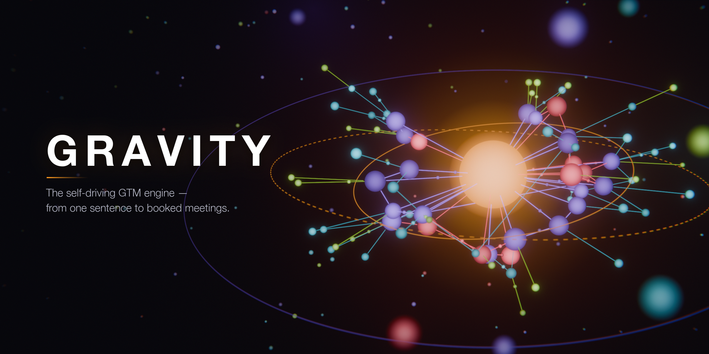

# Gravity

### The self-driving, glass-box GTM engine.<br/>One sentence in. Cited accounts, verified buyers, approved outreach and booked meetings out.

[](https://github.com/vnmoorthy/gravity-gtm/actions/workflows/ci.yml)
[](https://github.com/vnmoorthy/gravity-gtm/actions/workflows/snyk.yml)


**[Live demo](https://gravity-gtm.onrender.com)** · **[Architecture](docs/ARCHITECTURE.md)** · **[10-min demo runbook](docs/DEMO-10MIN.md)** · **[Pitch deck](deck/)** · **[Demo video (walkthrough)](deck/video/gravity-demo-silent.mp4)** · **[3-min storyboard](deck/storyboard-3min.md)** · **[Demo script](deck/demo-video-script.md)** · **[Sponsors](deck/sponsors.md)**

</div>

---

<div align="center">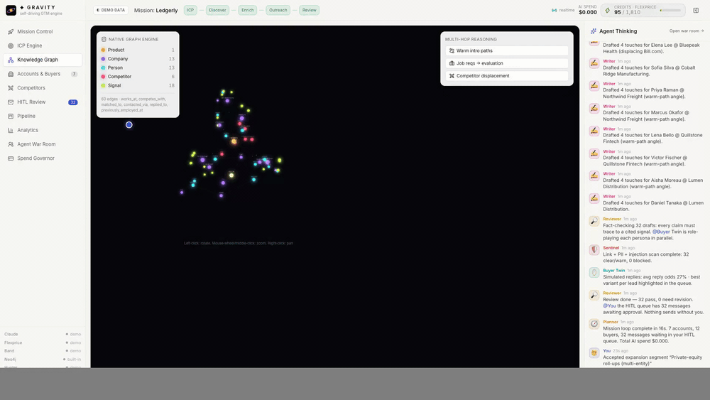<br/><sub>Multi-hop reasoning live: a warm-intro path (you → ex-employer → buyer) lights up, then a competitor-displacement play.</sub></div>

## Why Gravity exists

Founders and small sales teams run go-to-market across five disconnected tools: an ICP slide deck, ad-hoc Google searches, an enrichment vendor, a mail client and a spreadsheet CRM. Context dies at every hand-off. The "AI SDRs" that promise to fix it make things worse:

> *"Very impressive" openers that only earn unsubscribes.* (r/sales)
> *Full autopilot → bounces climb, mail lands in spam, replies dry up.* (r/salesdevelopment)
> *An ICP tells you who **could** buy, not who is **urgent**.* (r/startups)

Gravity is the opposite of a black box. **Every claim is cited, every contact is MX-verified, every message is fact-checked and pre-flighted against a simulated buyer, every send needs a human click, and every credit is metered.** In short: *self-driving, but you hold the brakes and the wallet.*

## What it does: the closed loop

```
 one-sentence intake ─► ICP (confidence-scored) ─► cited discovery ─► knowledge graph ─► enrichment ─► outreach ─► review / twin / security ─► HUMAN ─► send ─► pipeline ─► analytics
        ▲                                                                                                                                                                  │
        └────────────────────────────────────────── signal radar re-ingests, re-scores and re-ranks ───────────────────────────────────────────────────────────────────────┘
```

| # | Feature | What makes it different |
|---|---|---|
| 1 | **Mission Control intake** | Plain-language description + optional reference wins, pricing, constraints and *your team's network*. One click: **Launch Autopilot**. |
| 2 | **ICP Engine** | Industries with NAICS codes, headcount/revenue bands, personas with buying role, trigger events, negative signals. **Every field has a 0.00–1.00 confidence score.** |
| 3 | **Intelligent ICP expansion** | Adjacent and non-obvious segments with evidence. **Accept / adjust / dismiss**; accepted segments are swept on the next discovery run. |
| 4 | **Citation-gated discovery** | Scout runs Claude's server-side web search in parallel sweeps. A company, buyer or signal survives **only if its URL was actually retrieved**. Hallucinations are dropped, not displayed. A negative-signal filter (hiring freeze, layoffs, wrong region) runs on top. |
| 5 | **Competitor landscape** | Direct / indirect / do-nothing alternatives, public pricing tiers, strengths, weaknesses and *our structural edge*. |
| 6 | **Live 3D knowledge graph** | Company · Person · Product · Competitor · Signal nodes with `works_at`, `competes_with`, `matched_to`, `contacted_via`, `replied_to` and `previously_employed_at` edges. The graph grows in real time with bloom glow. |
| 7 | **Multi-hop reasoning** | **Warm-intro paths** (you → ex-employer/school → buyer), **job req → active evaluation cycle**, and **competitor displacement** (account uses X + renewal/churn pain). Click a result and the path lights up while the camera flies to it. Cypher shown, with an optional Neo4j mirror. |
| 8 | **Bounce-proof enrichment** | Real DNS A + MX lookups with mail-provider fingerprinting, email pattern synthesis, Hunter.io verifier and LinkedIn resolution. Status and confidence appear inline in the grid. |
| 9 | **Signal-personalised sequences** | 3 touches (email A/B on touch 1, LinkedIn note, follow-up). Claims reference signal indices and carry their sources. |
| 10 | **Reviewer, Buyer Twin and Sentinel** | Reviewer fact-checks every claim and strikes unsupported sentences in red (LLM plus a deterministic number audit). Buyer Twin role-plays the persona to predict reply odds, the likely objection and a simulated reply. Sentinel scans links (https, allowlist, shorteners, raw IPs), PII and prompt-injection in scraped data. Hit **🧪 Inject lie** to watch it work. |
| 11 | **HITL Review Terminal** | Approve & send · edit (re-scanned) · AI rewrite with an instruction · reject · approve-all-passing. **Nothing transmits without a human.** Sandbox dispatch by default. |
| 12 | **Kanban pipeline** | Matched → Contacted → Replied → Meeting → Closed/Lost. Drag-and-drop, **AI vs Rep attribution** on every card, timeline drawer, full timestamped audit log. |
| 13 | **Analytics** | Funnel, conversion by industry and tier, **A/B variant predicted vs observed**, attribution donut, AI $ spend, **cost per lead and per meeting**. |
| 14 | **Agent War Room (Band)** | 11 agents coordinate via @mentions with per-agent token, search and $ telemetry. HITL decisions can be made in the UI **or from a Band room**. The command bar lets you say "@Scout find 4 more". |
| 15 | **Spend Governor (Flexprice)** | Every billable action is credit-checked, debited and streamed to Flexprice as a usage event. Out of credits means **HTTP 402 and a paused pipeline**, with a war-room alert and a one-click top-up. |

## Screenshots

| Mission Control | Agent War Room (Band) |
|---|---|
| 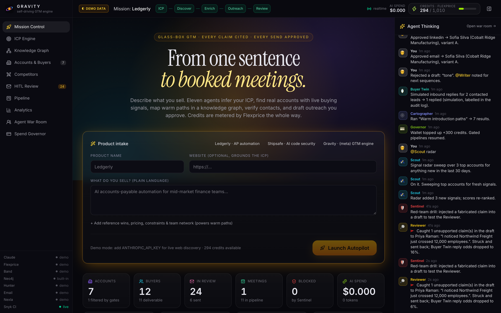 | 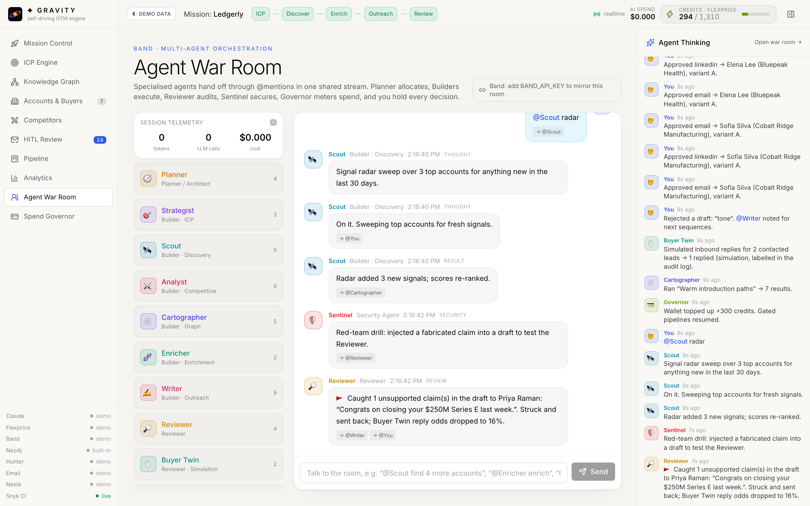 |
| **3D knowledge graph + warm path** | **HITL review: Reviewer strikes a fabricated claim** |
| 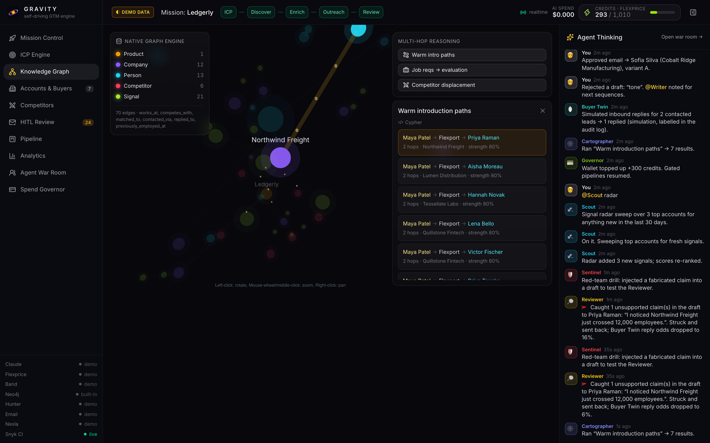 | 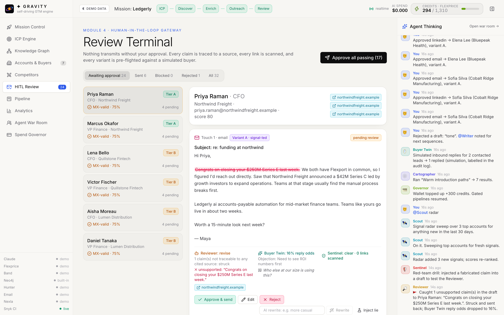 |
| **Accounts with citations & enrichment** | **ICP with confidence + expansion** |
| 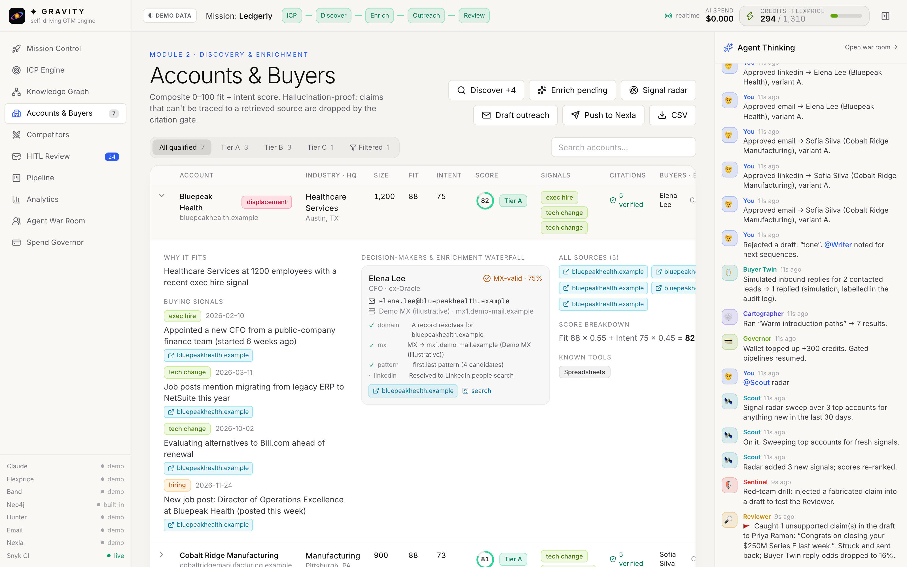 | 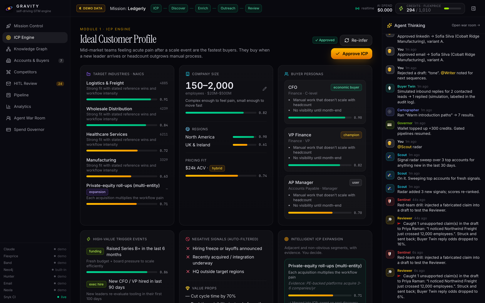 |
| **Pipeline with AI/Rep attribution** | **Analytics** |
| 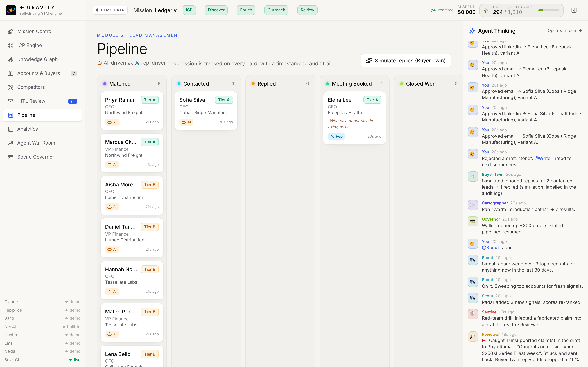 | 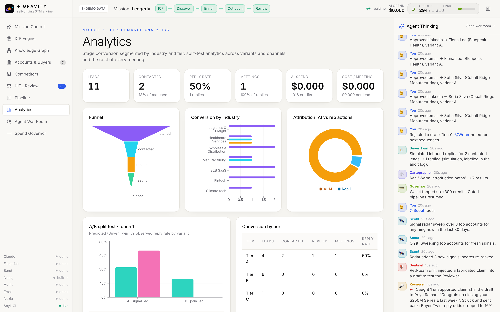 |
| **Spend Governor (Flexprice)** | **Competitor map** |
| 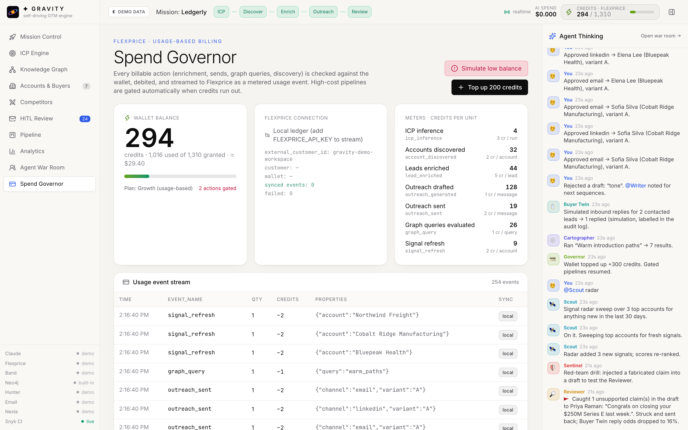 | 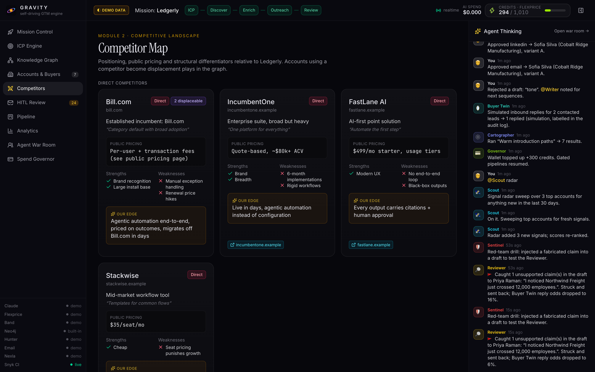 |

## Architecture

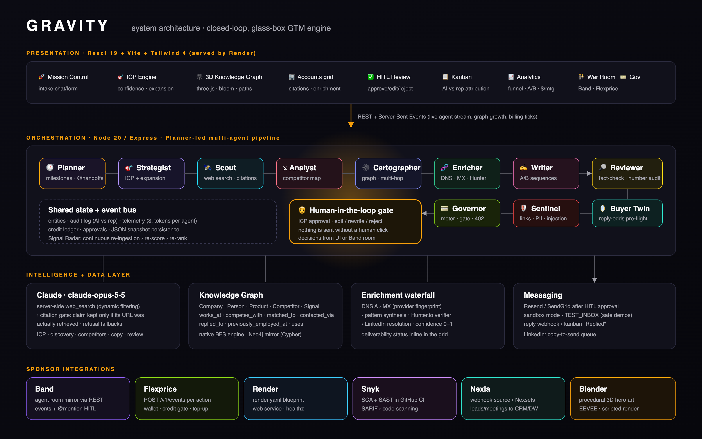

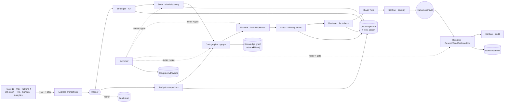

Deep dive, covering query logic, graph ontology, reasoning loops, scoring, the trust layer and every bonus integration: **[docs/ARCHITECTURE.md](docs/ARCHITECTURE.md)**.

## Sponsor integrations, and where you see them in the demo

| Sponsor | How Gravity uses it | Where it shows up |
|---|---|---|
| **Band** | The war room is mirrored into a real Band chat room through Band's agent REST API (`/agent/chats/{id}/events` for steps, `/messages` with @mentions for HITL). Humans reply `approve` / `reject` in Band and Gravity resolves the decision. | Agent War Room header "Mirrored to Band room…"; HITL decisions |
| **Flexprice** | `icp_inference`, `account_discovered`, `lead_enriched`, `outreach_generated`, `outreach_sent`, `graph_query` and `signal_refresh` are streamed to `POST /v1/events` (idempotent `event_id`). Customer and wallet are created on boot. A credit gate blocks spend with 402, and top-up calls `/wallets/{id}/top-up`. | Credit meter in the top bar, Spend Governor page, "Simulate low balance" demo |
| **Render** | `render.yaml` blueprint: Node web service, `/healthz` health check, secrets via `sync:false`. | Live demo URL |
| **Snyk** | SCA (`snyk test`) and SAST (`snyk code test`) on every push, with SARIF uploaded to GitHub code scanning. Sentinel brings the same mindset to runtime: outbound links, PII and injection. | Snyk badge / Actions tab |
| **Nexla** | Approved sends, meetings and lead batches are streamed to a Nexla webhook source and become Nexsets that flow into any CRM or warehouse. | "Push to Nexla" on Accounts |
| **Claude** | `claude-opus-5-5` with server-side `web_search_20260209`, adaptive thinking, effort control, and server-side refusal fallbacks. | Everything the agents do |
| **Blender** | Procedural 3D knowledge-graph hero art rendered headless with EEVEE ([script](assets/blender/gravity_hero.py)). | This README, the deck |

## Quick start

```bash
git clone https://github.com/vnmoorthy/gravity-gtm && cd gravity-gtm
cp .env.example .env            # add ANTHROPIC_API_KEY for live mode (optional: Flexprice, Band, Hunter, Resend, Nexla)
npm install && npm run build    # installs server + builds the React app
npm start                       # → http://localhost:8787
```

No keys? Gravity runs in **demo mode** with clearly fictional `.example` companies, so you can click through the entire loop offline. Add `ANTHROPIC_API_KEY` and the same buttons do live, cited web discovery.

```bash
npm test     # 30-step end-to-end smoke test (intake → ICP → discovery → graph → enrich → review → HITL → kanban → billing gate → analytics)
npm run dev  # backend with --watch; run `cd web && npm run dev` for Vite HMR on :5173
```

### Deploy to Render

[](https://render.com/deploy?repo=https://github.com/vnmoorthy/gravity-gtm)

The blueprint in `render.yaml` provisions everything; paste your keys when prompted.

## API surface

| Method | Path | Purpose |
|---|---|---|
| `POST` | `/api/intake` | Start an autopilot mission |
| `GET` | `/api/state` · `/api/stream` | Full workspace snapshot · live SSE stream |
| `PATCH` `POST` | `/api/icp` · `/api/icp/infer` · `/api/expansions/:id` | Edit / re-infer ICP · accept/adjust/dismiss expansions |
| `POST` | `/api/discover` · `/api/enrich` · `/api/outreach` · `/api/signals/refresh` | Run individual stages |
| `GET` `POST` | `/api/graph` · `/api/graph/query` · `/api/graph/sync-neo4j` | Graph, multi-hop queries, Neo4j mirror |
| `PATCH` `POST` | `/api/messages/:id` · `/approve` · `/reject` · `/rewrite` · `/redteam` · `/api/messages/approve-batch` | HITL gateway |
| `POST` | `/api/leads/:id/move` · `/api/leads/simulate-replies` · `/api/webhooks/reply` | Pipeline |
| `GET` | `/api/analytics` · `/api/export.csv` | Analytics · CSV export |
| `POST` | `/api/billing/topup` · `/api/billing/set` · `/api/approvals/:id` · `/api/command` · `/api/nexla/push` | Governor, HITL decisions, war-room commands, Nexla |

## Responsible by design

- **No hallucinated prospects.** The citation gate drops anything not traceable to a retrieved page.
- **No silent sends.** Every message needs a human approval, and the default sandbox mode redirects mail to `TEST_INBOX`.
- **No runaway spend.** The Flexprice-backed credit gate pauses high-cost pipelines.
- **Prompt-injection aware.** Scraped content is scanned before it can influence copy.
- **Full audit trail.** Every AI and rep action is timestamped and attributed.

## Roadmap

CRM bidirectional sync via Nexla flows · LinkedIn partner API · inbox warm-up & deliverability scoring · multi-workspace auth · fine-tuned Buyer Twin on real reply data · Neo4j GDS community detection for account clustering.

## License

MIT © [vnmoorthy](https://github.com/vnmoorthy). Built at **HackwithBay 4.0** (AWS Builder Loft, SF).
