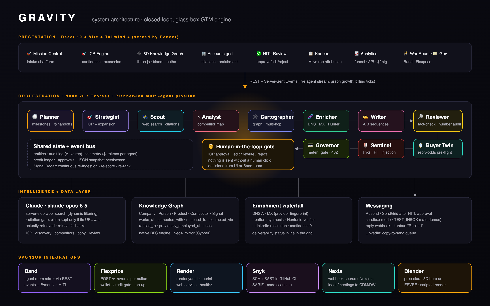

# Gravity: System Design & Architecture

> Technical specification covering query logic, graph ontology, reasoning loops and the bonus integrations.



## 1. Topology

| Tier | Component | Choice | Notes |
|---|---|---|---|
| Presentation | SPA | React 19, Vite, Tailwind 4, `react-force-graph-3d` + three.js `UnrealBloomPass`, Recharts | Hybrid layout: editorial headings over dense, spreadsheet-like operating surfaces. Collapsible "Agent Thinking" feed on every page. |
| Transport | REST + SSE | Express 4, `/api/stream` | Agent messages are pushed instantly; other state is reconciled with a debounced snapshot refetch. |
| Orchestration | Planner-led pipeline | `server/pipeline.js` | Deterministic control flow with LLM steps inside it. Each stage can also be run on its own. |
| Reasoning | LLM | Claude `claude-opus-5-5`, effort `low` for throughput | Server-side `web_search_20260209` for grounded discovery; server-side refusal fallbacks (`fallbacks: "default"`). |
| Graph | Property graph | `server/graph.js` | Native in-process engine with BFS multi-hop. Mirrors to Neo4j when `NEO4J_URI` is set (`/api/graph/sync-neo4j`). |
| Enrichment | Waterfall | `server/enrich.js` | `dns.resolve4` → `dns.resolveMx` (provider fingerprint) → pattern synthesis → Hunter `email-finder` → LinkedIn. |
| Messaging | Dispatch | `server/dispatch.js` | Resend / SendGrid. `DISPATCH_MODE=sandbox` (default) redirects to `TEST_INBOX`. |
| Billing | Metering + gate | `server/billing.js` | Local ledger is authoritative for gating; Flexprice `/v1/events` receives every event. |
| Collaboration | Multi-agent room | `server/agents.js`, `server/band.js` | @mention bus, per-agent telemetry, HITL approvals, Band mirror. |
| Persistence | Snapshot | `data/state.json` | Debounced writes; survives restarts. |

## 2. Agent roster & reasoning loop

```
Planner ──► Strategist ──► (HITL: optional ICP approval) ──► Scout ∥ Analyst ──► Cartographer ──► Enricher ──► Writer ──► Reviewer ∥ Buyer Twin ──► Sentinel ──► HUMAN ──► Dispatch
   ▲                                                                                                                                                         │
   └──────────────────────── Governor meters & gates every billable edge ─── Signal Radar re-ingests → re-score → re-rank ◄───────────────────────────────────┘
```

| Agent | Spec role | Responsibility |
|---|---|---|
| Planner | Planner / Architect | Parses the intake, publishes milestones, @mentions the next owner, posts the run summary |
| Strategist | Builder | ICP inference + expansion segments |
| Scout | Builder | Parallel cited discovery sweeps, signal radar |
| Analyst | Builder | Competitor landscape |
| Cartographer | Builder | Graph mutations + multi-hop queries |
| Enricher | Builder | Contact resolution waterfall |
| Writer | Builder | Multi-touch, A/B sequences; rewrites on human instruction |
| Reviewer | Reviewer | Claim-level fact checking, deterministic number audit, lint |
| Buyer Twin | Reviewer | Persona simulation, reply probability, objection, simulated reply |
| Sentinel | Security Agent | Outbound link scan, PII, prompt-injection quarantine, red-team drills |
| Governor | Spend Governor | Flexprice metering, credit gating, top-ups |

Each agent message carries `{agent, to[], kind, tokens, cost}`, so the war room doubles as operational telemetry: tokens, web searches and $ spend per agent, plus totals.

## 3. ICP inference

**Input:** product name, description, website (optional; triggers a 3-search grounding pass), reference wins, pricing/ACV, constraints.

**Output schema** (every field carries a `confidence` from 0.00 to 1.00):
`industries[{name, naics, rationale}]`, `company_size{headcount_min, headcount_max, revenue_band}`, `regions[]`, `personas[{title, function, seniority, buying_role, pains[]}]`, `triggers[{type, signal, why}]`, `negative_signals[]`, `value_props[]`, `pricing_fit{acv, motion}`, `expansions[{segment, rationale, evidence}]`.

Accepting an expansion appends it to `icp.industries` (flagged `expansion: true`), and the next Scout sweep targets it.

## 4. Discovery & the citation gate

1. The Planner fans out **two parallel Scout sweeps**: core ICP industries, plus an accepted expansion or the secondary industries. The Analyst runs concurrently.
2. Each sweep is a single Claude call with `web_search` (`max_uses: 7`). It must return `companies[{…, signals[{type,text,date,source_url}], buyers[{name,title,linkedin_url,source_url,prior_companies,schools}], tools_used, negative_signals, sources}]`.
3. **Citation gate:** the server collects every URL the search tool actually returned (`web_search_tool_result` blocks + text `citations`). An account's sources are matched by exact URL, then by hostname. **Zero matches means it's dropped** (`status: filtered`, `filter_reason: "Citation gate…"`). Each signal and buyer carries its own `verified` flag.
4. **Negative-signal filter:** freeze / layoffs / acquired / out-of-region signals filter the account.
5. **Scoring:**
   - `fit = 0.45·industry_match + 0.30·size_match + 0.25·buyer_coverage`
   - `intent = Σ signal_weight(type) × recency_multiplier (+12 if they use a competitor)`
   - `score = 0.55·fit + 0.45·intent` → Tier A ≥ 72, B ≥ 55, otherwise C.
   - Signal weights: funding 22, exec_hire 20, hiring 18, tech_change 18, expansion 14, product_launch 12, regulatory 12, news 8. Recency: under 45 days ×1.25, over 240 days ×0.6.

## 5. Knowledge graph ontology

**Nodes:** `Product` (you), `Company` (accounts, plus alumni employers and schools), `Person` (buyers + your team), `Competitor`, `Signal`.

**Edges:**

| Edge | From → To | Created when |
|---|---|---|
| `works_at` | Person → Company | Buyer discovered |
| `previously_employed_at` | Person → Company | Bio / team network |
| `studied_at` | Person → School | Bio / team network |
| `matched_to` | Company → Product | Account passes the gates (carries `score`) |
| `has_signal` | Company → Signal | Signal ingested |
| `competes_with` | Competitor → Product | Analyst mapping |
| `uses` | Company → Competitor | Tool/signal text mentions a competitor (displacement) |
| `contacted_via` | Person → Product | Message sent (carries `channel`) |
| `replied_to` | Person → Product | Lead reaches Replied |
| `same_as` | alias Company → account Company | Alumni name matches an account |

### Multi-hop queries

**Warm intro paths.** BFS from each team member over `{previously_employed_at, studied_at, works_at, same_as}` (depth ≤ 4) to any buyer:
```cypher
MATCH p=(me:Person {team:true})-[:PREVIOUSLY_EMPLOYED_AT|STUDIED_AT*1..2]-(x)-[:PREVIOUSLY_EMPLOYED_AT|STUDIED_AT|WORKS_AT]-(buyer:Person)-[:WORKS_AT]->(c:Company)
WHERE (c)-[:MATCHED_TO]->(:Product)
RETURN p ORDER BY length(p) LIMIT 25
```
Strength = `max(0.35, 1 − 0.2·(hops − 2))`. The Writer receives the path and weaves in the shared connection.

**Job reqs → active evaluation cycles.** A hiring signal whose text overlaps persona keywords means the account is likely evaluating:
```cypher
MATCH (c:Company)-[:HAS_SIGNAL]->(s:Signal {type:'hiring'}), (c)-[:MATCHED_TO]->(:Product)
WITH c, s, [w IN $personaKeywords WHERE toLower(s.text) CONTAINS w] AS hits
RETURN c.name, s.text, size(hits) AS overlap ORDER BY overlap DESC
```

**Competitor displacement.** `(Company)-[:USES]->(Competitor)` joined with renewal/churn/migration/cost/frustration signals:
```cypher
MATCH (c:Company)-[:USES]->(k:Competitor)-[:COMPETES_WITH]->(:Product)
OPTIONAL MATCH (c)-[:HAS_SIGNAL]->(s:Signal) WHERE s.text =~ '(?i).*(renew|churn|migrat|switch|cost|frustrat).*'
RETURN c.name, k.name, collect(s.text) AS pain ORDER BY size(pain) DESC
```

**Continuous signal ingestion.** Signal Radar (`/api/signals/refresh`, or "@Scout radar") re-searches the top accounts for anything new, appends `fresh` signals, re-scores and re-ranks, and the graph updates live.

## 6. Enrichment waterfall

| Step | Check | Output |
|---|---|---|
| 1 | `dns.resolve4(domain)` | domain resolves |
| 2 | `dns.resolveMx(domain)` | MX hosts + provider fingerprint (Google Workspace, Microsoft 365, Proofpoint, Mimecast) |
| 3 | Pattern synthesis | `first.last` (prior .42), `first` (.24), `flast` (.18), `firstlast` (.08) |
| 4 | Hunter `email-finder` (if keyed) | verified email + score |
| 5 | LinkedIn | profile URL from the cited source, else a resolved people search |

Status is one of `verified`, `likely` (pattern + MX valid), `invalid` (no MX) or `error`, with `email_confidence` from 0 to 1. Only `verified` and `likely` contacts get sequences.

## 7. Outreach & the trust layer

- **Writer.** For each lead it drafts touch 1 as email variant A (signal-led) and variant B (pain-led), touch 2 as a LinkedIn note (≤ 280 chars) and touch 3 as a follow-up. It receives verified signals by index, the persona's pains, the warm path and the displacement edge. Each claim cites a `signal_index`, which is mapped to its source URL.
- **Reviewer.** An LLM fact-check against the evidence, union-ed with a deterministic **number audit**: every `$` amount, funding round, `%`/`x` figure or "N employees" in the copy must appear in the evidence. Unsupported sentences are struck through in the UI, the verdict becomes `revise`, and Buyer Twin's reply odds are cut by 60%.
- **Buyer Twin.** Role-plays the persona and returns `reply_probability`, `objection` and `twin_reply`. The best step-1 variant is starred as the "Twin's pick".
- **Sentinel.** Flags non-https links, URL shorteners, raw-IP links, off-allowlist domains, phone numbers, personal emails and prompt-injection strings (including in scraped signals). Any high-severity finding sets the message to `blocked`, and it cannot be approved until edited.
- **HITL gateway.** Approve, edit (re-scanned), AI rewrite with an instruction, reject, or batch-approve everything that passes. Approving one step-1 variant retires its sibling (`not_chosen`). Approval → Governor gate → dispatch → lead moves to `contacted` (actor AI, approved by rep) → Nexla push.

## 8. Lead management & analytics

- Stages: `matched → contacted → replied → meeting → closed | lost`. Every transition is appended to `lead.history[{stage, at, actor: ai|rep, note}]`; dragging a card is a rep action. The global audit log records every AI and rep action with its payload.
- Analytics compute stage reach (a lead counts toward every stage it has passed), conversion by industry and tier, step-1 variant performance (drafted, sent, replies, reply rate and Twin-predicted rate), channels, AI vs rep transition attribution, AI $ spend, credits used, and cost per lead and per meeting.
- Replies arrive via the `/api/webhooks/reply` webhook (inbound parse), or via **Buyer Twin simulation** for demos. Simulated replies are labelled as such in the audit log.

## 9. Bonus integrations

### Band (multi-agent orchestration)
- `GET /agent/me` → `POST /agent/chats {"chat":{}}` (or reuse `BAND_CHAT_ID`) → `GET /agent/chats/{id}/participants`.
- Agent steps go to `POST /agent/chats/{id}/events` with `message_type` set to `task`, `thought`, `tool_call`, `tool_result` or `error`, plus metadata `{agent, tokens, cost_usd}`.
- HITL requests go to `POST /agent/chats/{id}/messages` with `mentions[]` of the room's humans.
- The app polls `GET /agent/chats/{id}/messages?status=pending`. "approve|reject [hitl_id]" resolves the approval in Gravity, and the message is then marked `/processed`.
- Auth: `X-API-Key: band_a_…`.

### Flexprice (usage-based billing)
- On boot: `POST /customers {external_id}` → `GET /customers/wallets?id=…&include_real_time_balance=true` → create a wallet if missing.
- Per action: `POST /events {event_name, external_customer_id, event_id, timestamp, source:"gravity-gtm", properties{quantity, credits, …}}`.
- Meters (credits per unit): icp_inference 3, account_discovered 2, lead_enriched 5, outreach_generated 1, outreach_sent 2, graph_query 1, signal_refresh 2.
- Gate: if the balance can't cover an action, the server throws `CreditError` (HTTP 402), increments `blocked`, and the Governor posts to the war room. The pipeline pauses cleanly.
- Top-up: `POST /wallets/{id}/top-up {credits_to_add, transaction_reason:"PURCHASED_CREDIT_DIRECT", idempotency_key}`.

### Snyk
`.github/workflows/snyk.yml` runs SCA (`snyk test --all-projects --severity-threshold=high`) and SAST (`snyk code test`) and uploads SARIF to GitHub code scanning. It needs the `SNYK_TOKEN` secret.

### Nexla
`NEXLA_WEBHOOK_URL` (+ optional `NEXLA_API_KEY` as `Authorization: Basic`) receives `outreach_sent`, `meeting_booked` and `lead_batch` records. Nexla auto-detects the schema into Nexsets for any downstream CRM or warehouse.

### Render
The `render.yaml` blueprint defines a `runtime: node` web service: `npm install && npm run build`, `npm start`, `healthCheckPath: /healthz`, with secrets set via `sync: false`.

## 10. Failure modes & safeguards

| Risk | Mitigation |
|---|---|
| LLM invents a company/person | Citation gate (retrieved-URL matching) + per-signal `verified` flags |
| Copy overclaims | Reviewer + deterministic number audit + struck-through UI + human gate |
| Scraped prompt injection | Sentinel regex quarantine + blocked status |
| Bounces | MX validation before any sequence is drafted |
| Runaway cost | Per-action credit gate, per-agent $ telemetry, `effort: low` on high-volume calls |
| Model refusal | Server-side `fallbacks: "default"` |
| Accidental real sends in demos | `DISPATCH_MODE=sandbox` default → `TEST_INBOX` |
| Missing keys | Every integration degrades to a clearly-labelled demo/local mode, and the UI shows live/demo status per integration |
